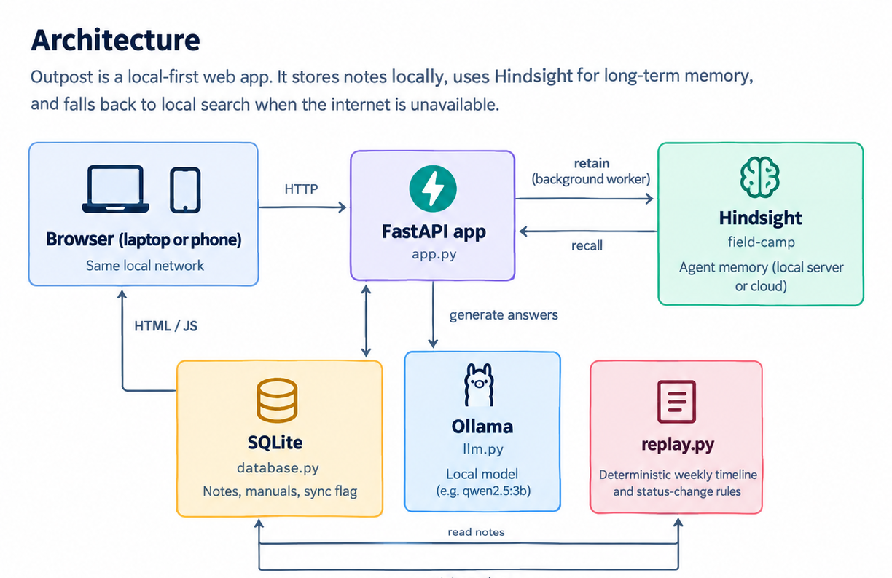

# Outpost

**Shared memory for remote teams. Every answer comes with a source and a trust label.**

Outpost is a local-first web app for teams working in the field: camps, sites, and expeditions. Crew members post short reports from their phones — a water test, a broken generator, or a supply update. Days later, anyone can ask what happened and get an answer built from remembered notes, with the day, author, and trust level attached.

Outpost uses [Hindsight](https://github.com/vectorize-io/hindsight) as its memory layer, with FastAPI, SQLite, and a local model served by Ollama. All seeded data is synthetic.

## The problem

An LLM without memory can answer:

> Where is the clean water source?

with a confident, generic answer about wells or bottled water. It knows nothing about the camp, there is no source to check, and in the field a wrong answer can have real consequences.

With Outpost's memory on, the same question can return:

> **East Creek (Source B), east of camp.**  
> Day 3 · Ravi · Verified by team lead

The answer is backed by the team's stored memory rather than generic model knowledge.

## What Outpost does

- **Post notes** with an author, role, camp day, and trust label.
- **Ask the camp** in plain English with a Memory on/off switch.
- **Citations are built in code**, so day, author, and trust come from the stored note rather than model-generated citations.
- **Manuals become memory.** Uploaded `.txt` or `.md` manuals are chunked and retained as an **Official document**.
- **Weekly replay** shows a day-by-day timeline and highlights status changes. It is deterministic and rule-based.
- **Memory activity log** shows retain and recall events as they happen.
- **Local fallback.** If Hindsight is unreachable, Outpost can search local SQLite notes and answer using the local Ollama model. Notes that could not reach Hindsight are re-sent when it becomes reachable.

## Architecture

The core flow is:

**Browser → FastAPI → Hindsight / SQLite / Ollama**

- **SQLite** is the local source of truth for notes, manuals, and sync state.
- **Hindsight** provides long-term agent memory through `retain` and `recall`.
- **Ollama** provides local answer generation by default.
- **replay.py** creates the deterministic weekly timeline and status changes.
- **FastAPI** connects these pieces and adds citations from stored notes.

### Files and their roles

| File | Role |
|---|---|
| `app.py` | FastAPI routes, recall-to-SQLite mapping, answer and citation logic |
| `memory.py` | Hindsight client, retain worker, recall, and background re-sync |
| `database.py` | SQLite storage for notes, manual chunks, and sync state |
| `llm.py` | OpenAI-compatible chat client, Ollama by default |
| `replay.py` | Deterministic weekly timeline and status-change rules |
| `static/index.html` | Single-file dashboard |
| `seed.py` | Posts synthetic seed notes through the API |
| `manual_generator.md` | Synthetic generator manual used as an official document |

## How Hindsight is used

Outpost uses one Hindsight bank: `field-camp`.

### Retain

Every note, and each manual chunk, is written to Hindsight by a background worker. The memory includes the camp day, time, author, role, and trust label.

Each note uses a `document_id` such as `note-<id>`, allowing a recalled memory to map back to its original SQLite row.

### Recall

When Memory is enabled, `/api/ask?memory=on` recalls relevant memories from Hindsight.

Outpost then maps those memories back to SQLite, adds a local keyword match so a brand-new note is not missed, and sends the resulting notes to the LLM.

### Citations

Citations are rebuilt by the application from stored notes.

The model does not decide the day, author, or trust label shown in the UI.

### Catch-up sync

If Hindsight is unreachable, the note remains stored locally with its sync flag unset. A background loop retries the upload when Hindsight becomes reachable again.

### Weekly replay

The weekly replay is **not a Hindsight feature**. `replay.py` uses deterministic rules to identify status changes, so it does not ask the model to invent a timeline.

## Working without internet

Outpost is **local-first, not fully offline**.

| Component | Without internet |
|---|---|
| Dashboard | Works |
| Posting notes | Works — saved to SQLite immediately |
| Weekly replay | Works — rule-based |
| Ask + local Ollama + local Hindsight | Works |
| Ask + local Ollama + Hindsight Cloud | Falls back to local keyword search |
| Ask + hosted LLM such as Groq | Does not work |

Phones only need to be connected to the same local network as the machine running Outpost. They do not need internet access to use the local app.

When Hindsight is unavailable, new notes are saved locally first and can be synchronized to Hindsight when connectivity returns.

## Limitations
All seeded data is synthetic. Outpost is a prototype, not a safety system.

## Links

- [Hindsight on GitHub](https://github.com/vectorize-io/hindsight)
- [Hindsight documentation](https://hindsight.vectorize.io/)
- [What is agent memory](https://vectorize.io/what-is-agent-memory)
